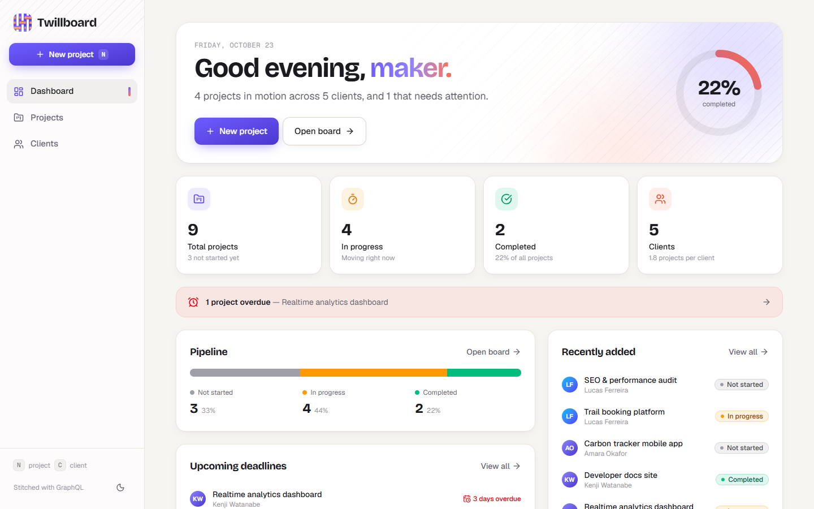
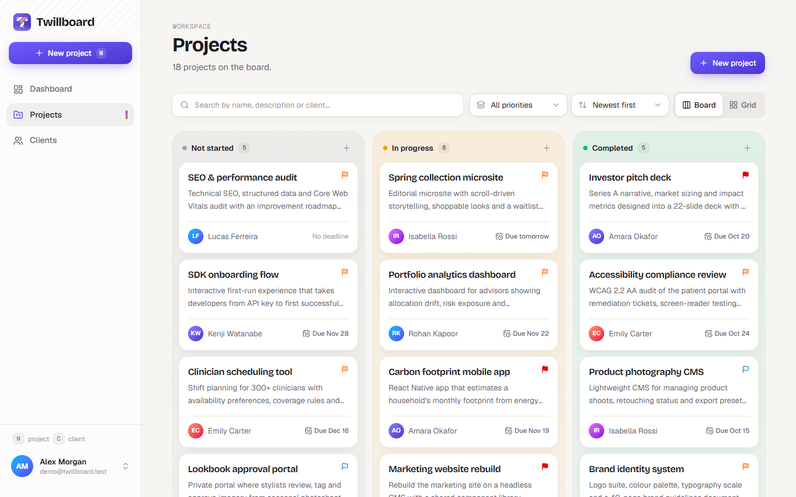
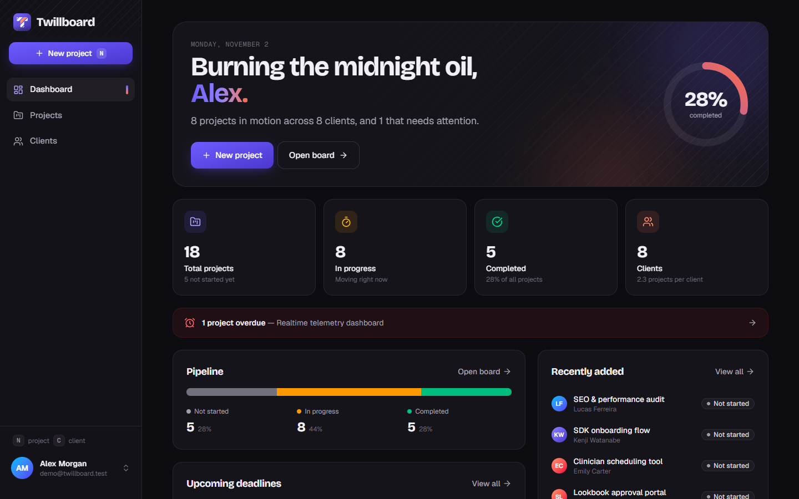
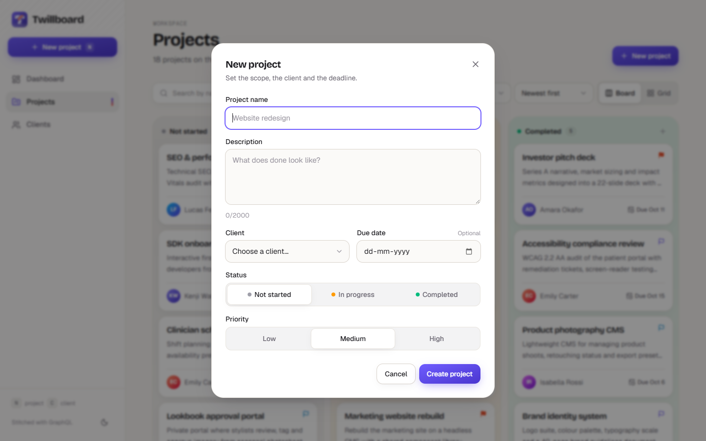
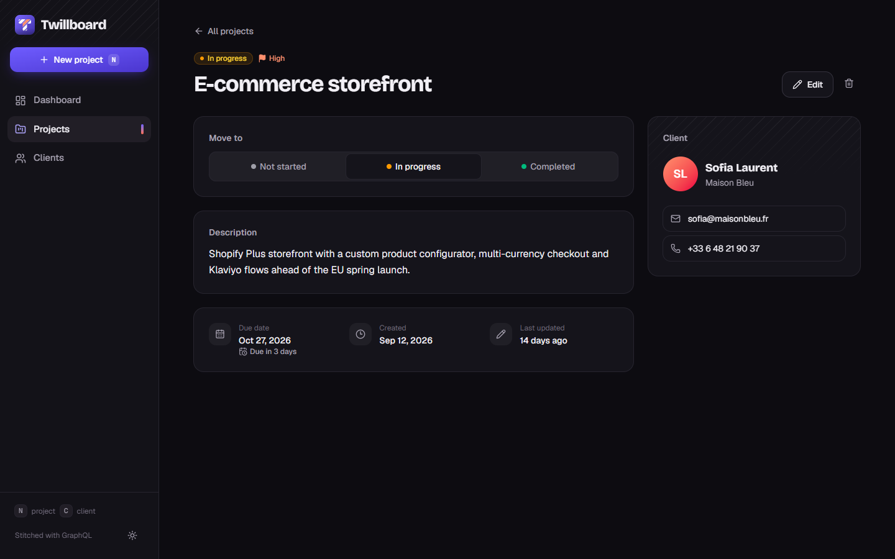
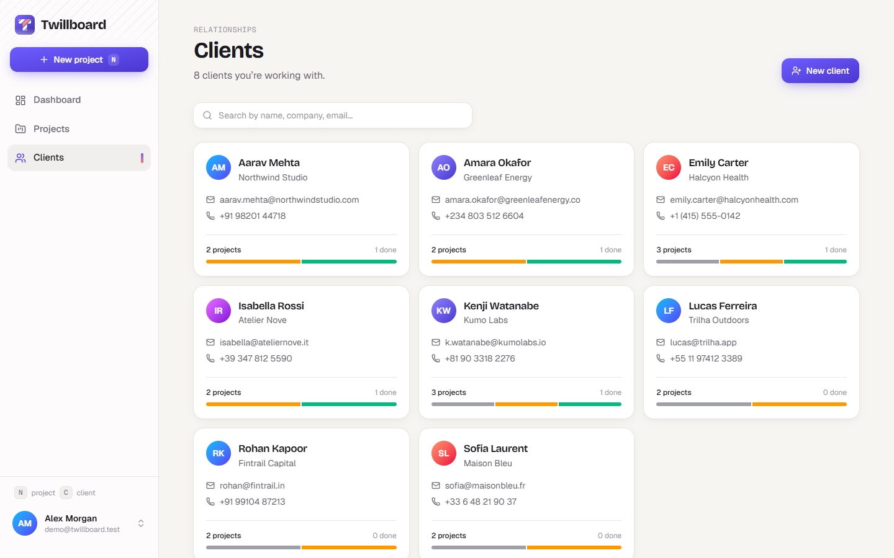
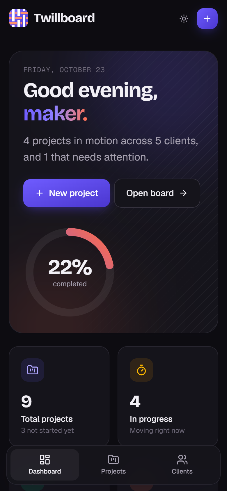

<div align="center">


# Twillboard

**Clients and projects, woven into one board.**

A calm, fast project manager for freelancers and small studios — built with React 19, GraphQL, Express 5 and MongoDB.


<br />



</div>

## Features

- **Dashboard** — greeting, completion ring, stat tiles, pipeline breakdown, upcoming deadlines, recent projects and top clients.
- **Kanban board** — drag cards between *Not started → In progress → Completed*. Updates are optimistic (instant) and roll back if the server rejects them.
- **Grid view with filters** — full-text search, status / priority filters and sorting. Every filter lives in the URL, so views are shareable and survive a refresh.
- **Projects** — priority, due dates with “due in 3 days” / overdue tracking, and a one-click status switcher.
- **Clients** — profiles with contact links, company, and a progress thread showing how their projects are going. Deleting a client tells you exactly how many projects go with them.
- **Validation everywhere** — instant client-side checks that mirror the server's Mongoose rules, with server errors mapped back onto the right field.
- **Light & dark themes** — follows your OS, remembers your choice, no flash on load.
- **Keyboard shortcuts** — <kbd>N</kbd> new project, <kbd>C</kbd> new client.
- **Responsive** — sidebar on desktop, top bar + floating tab bar on mobile.
- **Accessible** — native `<dialog>` modals (focus trap, <kbd>Esc</kbd>), labelled controls, `aria-invalid` errors, reduced-motion support.

<table>
  <tr>
    <td></td>
    <td></td>
  </tr>
  <tr>
    <td></td>
    <td></td>
  </tr>
  <tr>
    <td></td>
    <td align="center"></td>
  </tr>
</table>

## Tech stack

| Layer | Tech |
|---|---|
| Frontend | React 19, React Router 8 (data router, lazy-loaded routes), Apollo Client 4, Tailwind CSS 4, lucide icons, sonner toasts |
| Build | Vite 8, ESLint 10 |
| API | GraphQL Yoga on Express 5, schema-first SDL, DataLoader batching (no N+1 queries) |
| Database | MongoDB Atlas via Mongoose 9 with schema validation, timestamps and indexes |
| Runtime | Node.js 24 LTS (built-in `--watch` and `--env-file`, no nodemon/dotenv) |

### Architecture notes

- **One deployable.** In production, Express serves both `/graphql` and the built React app.
- **Same-origin in development.** Vite proxies `/graphql` to the API, so there's no CORS setup to fight.
- **Typed enums end to end.** `ProjectStatus` / `ProjectPriority` are GraphQL enums mapped to the strings stored in MongoDB.
- **Safe errors.** Validation, bad IDs and duplicate emails become `BAD_USER_INPUT` errors with per-field messages; unexpected errors are masked in production.
- **Fail fast.** The server validates its environment and database connection at startup with clear messages, and shuts down gracefully.

## Getting started

**Requirements:** Node.js 24+ and a free [MongoDB Atlas](https://www.mongodb.com/atlas) cluster (or a local MongoDB).

```bash
git clone https://github.com/thedeepanshu/project-management-app.git
cd project-management-app
npm install                 # installs the API and the client (npm workspaces)
cp .env.example .env        # then set MONGO_URI
npm run seed                # optional: demo clients & projects
npm run dev                 # API on :5000 + app on :5173
```

Open **http://localhost:5173**. The GraphQL playground (GraphiQL) is at **http://localhost:5000/graphql** in development.

### Scripts

| Command | What it does |
|---|---|
| `npm run dev` | Runs the API (auto-restarts on changes) and the Vite dev server together |
| `npm run build` | Builds the client into `client/dist` |
| `npm start` | Starts the API; with `NODE_ENV=production` it also serves the built app |
| `npm run seed` | Adds demo data to an empty database (`npm run seed -- --reset` wipes it first) |
| `npm run lint` | Lints the client |

### Environment variables

| Variable | Required | Description |
|---|---|---|
| `MONGO_URI` | ✅ | MongoDB connection string |
| `PORT` | | API port (default `5000`) |
| `NODE_ENV` | | `production` disables GraphiQL and serves the built client |
| `CLIENT_ORIGIN` | | Comma-separated origins allowed by CORS, if the app is hosted on a separate domain |

## GraphQL API

```graphql
query Dashboard {
  stats { totalProjects completionRate overdue byStatus { status count } }
  projects(status: IN_PROGRESS) { name priority dueDate isOverdue client { name } }
}

mutation {
  addProject(input: {
    name: "Website redesign"
    description: "New marketing site"
    clientId: "…"
    priority: HIGH
    dueDate: "2026-12-01"
  }) { id status }
}
```

Full schema: [`server/graphql/typeDefs.js`](server/graphql/typeDefs.js).

## Project structure

```
├── server/
│   ├── config/        # env validation, MongoDB connection
│   ├── graphql/       # typeDefs, resolvers, DataLoaders, error mapping
│   ├── models/        # Mongoose schemas with validation
│   ├── scripts/seed.js
│   └── index.js       # Express + GraphQL Yoga entry point
└── client/
    ├── public/        # favicon, app icons, manifest, social image
    └── src/
        ├── components/  # ui primitives, layout, projects, clients, brand
        ├── graphql/     # queries, mutations, fragments
        ├── hooks/       # useForm, useTheme, useSetProjectStatus…
        ├── lib/         # Apollo client, formatting, validation, enum metadata
        └── pages/       # Dashboard, Projects, ProjectDetail, Clients, ClientDetail
```

---

<div align="center">Built by <a href="https://github.com/thedeepanshu">Deepanshu Saini</a></div>
