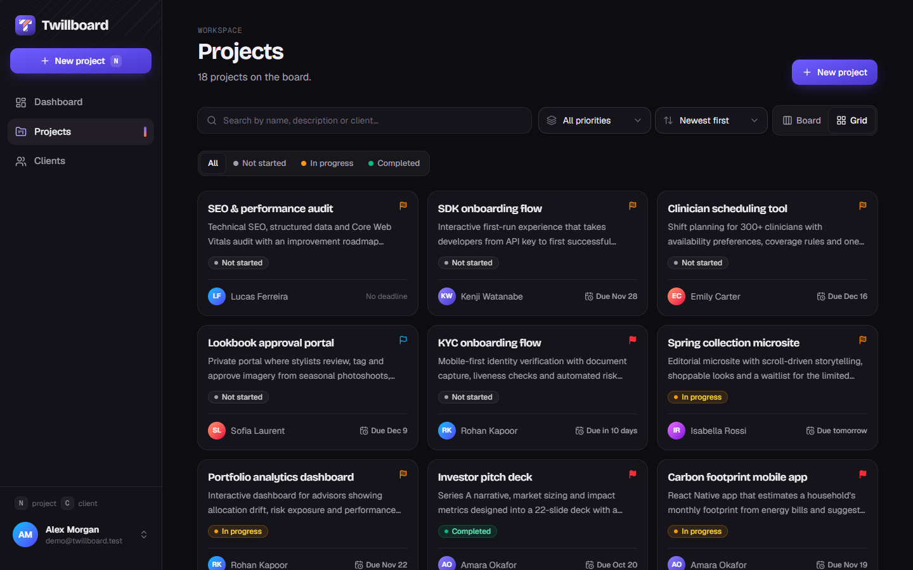
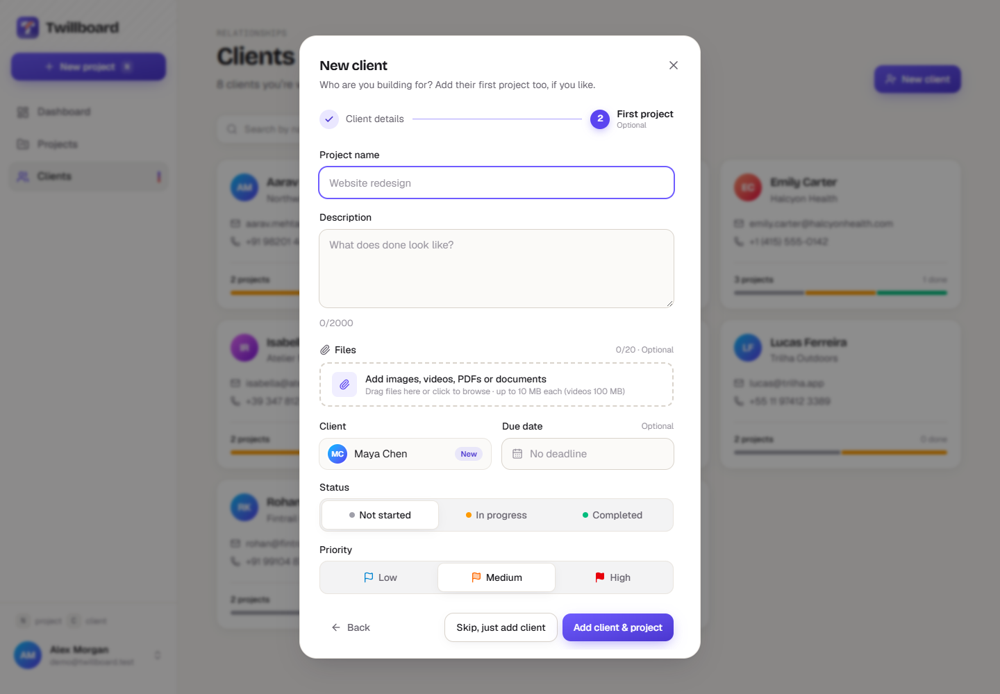
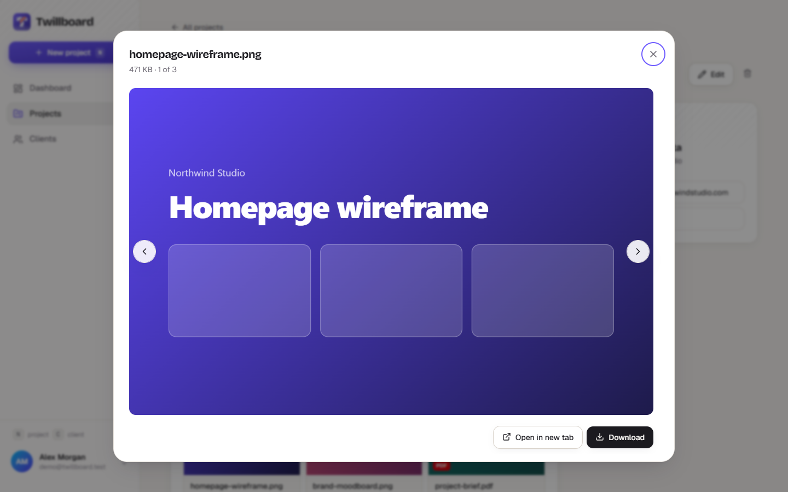
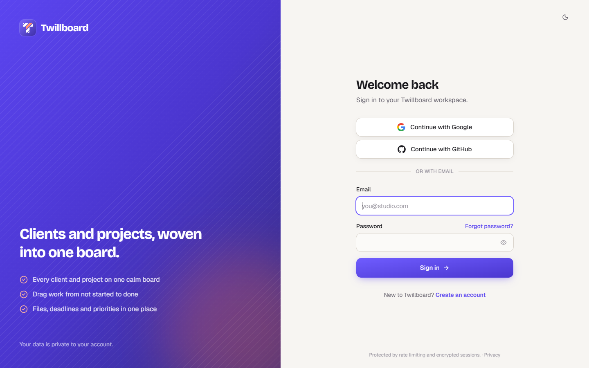
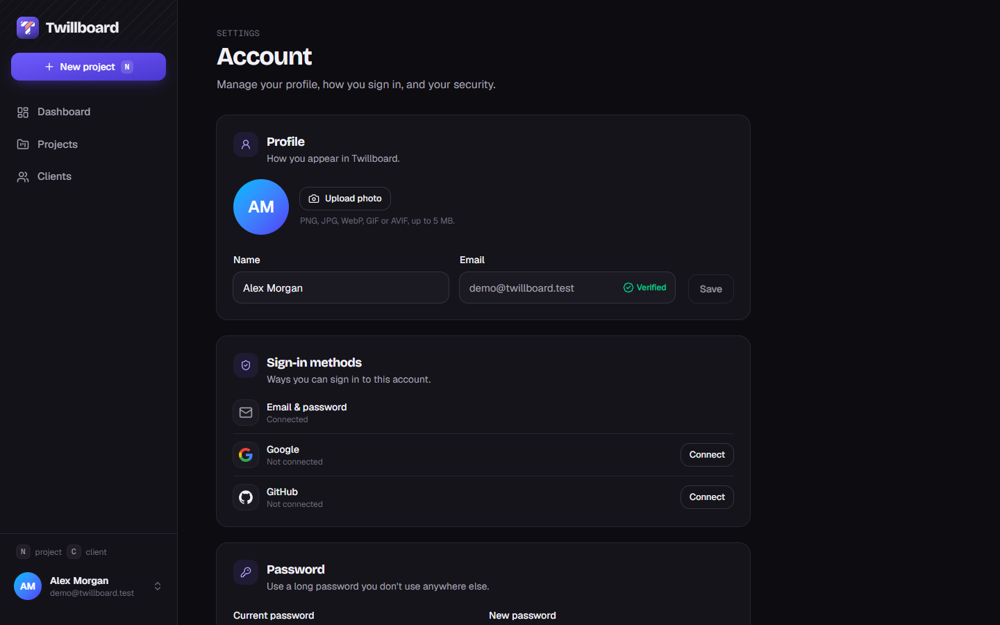
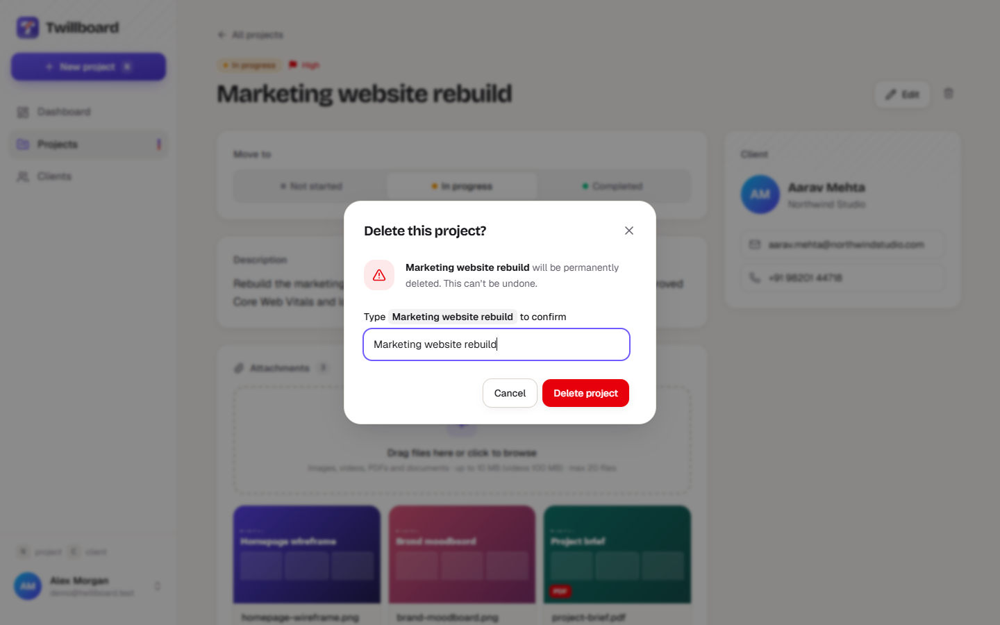

<div align="center">


# Twillboard

**Clients and projects, woven into one board.**

A calm, fast project manager for freelancers and small studios — built with React 19, GraphQL, Express 5 and MongoDB.

**[Open the live app →](https://twillboard.vercel.app)**


<br />


</div>

## Features

**Accounts**

- **Sign in your way** — email and password, or Google, GitHub and Microsoft. Every workspace is private to its account.
- **Email flows** — verification on sign-up, password reset, and a notice if someone tries to register with your address.
- **Account page** — name and profile photo (uploaded from your device), linked sign-in methods, password change, a list of signed-in devices you can sign out, and account deletion.
- **Clear feedback** — a "Signing out…" dialog, friendly messages for failed or cancelled provider sign-ins, and social buttons that reset if you come back with the browser's Back button.
- **Privacy policy** — a public page at [`/privacy`](https://twillboard.vercel.app/privacy), linked from the sign-in screens.

**Work**

- **Dashboard** — time-of-day greeting, completion ring, stat tiles, overdue alert, pipeline breakdown, upcoming deadlines, recently added projects and top clients.
- **Kanban board** — drag cards between *Not started → In progress → Completed*, or add a project straight into a column. Updates are optimistic (instant) and roll back if the server rejects them.
- **Grid view with filters** — full-text search, status and priority filters, and sorting. Every filter lives in the URL, so views are shareable and survive a refresh.
- **Projects** — priority, due dates with “due in 3 days” / overdue tracking, and a one-click status switcher.
- **Clients** — searchable profiles with contact links, company, and a progress thread showing how their projects are going. Photos can be uploaded or linked by URL, and fall back to coloured initials.
- **New client wizard** — enter the client's details, then optionally add their first project in the same dialog, or just add the client for now.
- **Safe deletes** — deleting a client or project asks you to type its name first. Deleting a client also tells you exactly how many projects go with them.

**Files**

- **Attachments** — images, videos, PDFs and Office documents, added while creating or editing a project or on its page. Up to 20 files per project, 10 MB each (videos 100 MB).
- **Direct uploads** — files go straight to Cloudinary with live progress. A failed upload offers **Retry**, and files from a cancelled form are cleaned up.
- **Attachment viewer** — images, videos and PDFs preview in-app, and Office files open in Microsoft's online viewer. Previews load lazily over a blurred thumbnail with their space reserved, so the dialog doesn't jump. Move between files with the arrow keys, open them in a new tab, or download them.

**Interface**

- **Light & dark themes** — follows your OS, remembers your choice, no flash on load.
- **Custom controls** — themed dropdowns and a date picker with shortcuts like *Tomorrow* and *Next week*.
- **Keyboard shortcuts** — <kbd>N</kbd> new project, <kbd>C</kbd> new client.
- **Validation everywhere** — instant client-side checks that mirror the server's Mongoose rules, with server errors mapped back onto the right field.
- **Responsive** — sidebar on desktop, top bar + floating tab bar on mobile.
- **Accessible** — native `<dialog>` modals (focus trap, <kbd>Esc</kbd>), labelled controls, `aria-invalid` errors, reduced-motion support.

### Screenshots

<table>
  <tr>
    <td width="50%"><br /><sub>Kanban board</sub></td>
    <td width="50%"><br /><sub>Grid view with filters</sub></td>
  </tr>
  <tr>
    <td><br /><sub>Dashboard in dark mode</sub></td>
    <td><br /><sub>Clients</sub></td>
  </tr>
  <tr>
    <td><br /><sub>New client, with an optional first project</sub></td>
    <td><br /><sub>New project</sub></td>
  </tr>
  <tr>
    <td><br /><sub>Project page with attachments</sub></td>
    <td><br /><sub>Attachment viewer</sub></td>
  </tr>
  <tr>
    <td><br /><sub>Sign in</sub></td>
    <td><br /><sub>Account</sub></td>
  </tr>
  <tr>
    <td><br /><sub>Type the name to delete</sub></td>
    <td align="center"><br /><sub>Mobile</sub></td>
  </tr>
</table>

## Tech stack

| Layer | Tech |
|---|---|
| Frontend | React 19, React Router 8 (data router, lazy-loaded routes), Apollo Client 4, Tailwind CSS 4, lucide icons, sonner toasts |
| Build | Vite 8, ESLint 10 |
| API | GraphQL Yoga on Express 5, schema-first SDL, DataLoader batching (no N+1 queries) |
| Database | MongoDB Atlas via Mongoose 9 with schema validation, timestamps and indexes |
| Auth | Better Auth (self-hosted, MongoDB adapter): email/password + OAuth (Google, GitHub, Microsoft), Gmail SMTP via Nodemailer |
| Files | Cloudinary signed direct uploads, on-the-fly thumbnails, automatic cleanup on delete |
| Hosting | Vercel (CDN + one Vercel Function), MongoDB Atlas, Cloudinary |
| Runtime | Node.js 24 LTS (built-in `--watch` and `--env-file`, no nodemon/dotenv) |

### Architecture notes

- **One app, two ways to run it.** On Vercel, the React build is served from the CDN and the whole API runs as one Vercel Function (`api/index.js`) on the same domain. On a plain server, `npm start` serves both from Express.
- **Same-origin in development.** Vite proxies `/graphql` and `/api` to the API, so the session cookie is first-party and there's no CORS setup to fight.
- **Typed enums end to end.** `ProjectStatus` / `ProjectPriority` are GraphQL enums mapped to the strings stored in MongoDB.
- **Safe errors.** Validation, bad IDs and duplicate emails become `BAD_USER_INPUT` errors with per-field messages; unexpected errors are masked in production.
- **Fail fast.** The server validates its environment and database connection at startup with clear messages, and shuts down gracefully.
- **Built for serverless.** The app and its database connection are created once per function instance and reused. Emails and auth background work use `waitUntil`, so they finish after the response is sent.
- **Optional features degrade gracefully.** `GET /api/config` tells the client what's enabled; with no file storage configured, upload controls simply don't appear.
- **Uploads never touch the API.** The server signs a short-lived Cloudinary upload restricted to the user's own folder; the browser uploads directly, and GraphQL only accepts metadata for files in that folder.

## Security

| Area | What's in place |
|---|---|
| **Passwords** | 10–128 characters, hashed with scrypt (salted), never stored or logged in plain text. Passwords found in known breaches are rejected ([Have I Been Pwned](https://haveibeenpwned.com/Passwords), k-anonymity: only 5 characters of a hash leave the server). |
| **Email verification** | Required before an email/password account can sign in. Links expire after 24 hours. |
| **Password reset** | Single-use links that expire after 30 minutes. A reset signs the user out on every device. |
| **Sessions** | Random token in an `HttpOnly`, `SameSite=Lax` cookie (`Secure` in production), 7-day sliding expiry, checked against the database on every request so revocation is instant. Users can see and sign out any device. |
| **Account enumeration** | Sign-up and "forgot password" respond identically whether or not an email is registered; the real owner gets a heads-up email instead. Emails are sent off the request path, so response timing doesn't leak either. |
| **Brute force** | Per-IP rate limits stored in MongoDB: sign-in 10 / 5 min, sign-up 5 / hour, reset requests 5 / hour, verification emails 3 / 15 min. The client IP comes from the connection (or one trusted proxy), never from a spoofable header. |
| **OAuth** | Google, GitHub and Microsoft with `state` + PKCE. Provider tokens are stored encrypted (XChaCha20-Poly1305). Accounts link automatically only when the provider has verified the email. |
| **CSRF & redirects** | Auth requests are checked against trusted origins (Origin + Fetch Metadata); `callbackURL`s outside the app are refused, and the client only follows same-app redirects. |
| **Authorization** | Every client, project and file has an owner. All reads and writes are scoped to the signed-in user, so another user's ID behaves like one that doesn't exist. |
| **Uploads** | Short-lived signatures per account (60 / minute), restricted to the user's own folder. A file is only saved if its URL is exactly that user's upload. Profile photos are upload-only and can't be set to an arbitrary link. |
| **API hardening** | GraphQL depth (8) and alias (15) limits, a 100 KB request cap enforced by counting bytes, schema introspection and "did you mean" hints disabled in production, unexpected errors masked. |
| **Headers** | A strict Content-Security-Policy (no inline scripts), HSTS, `frame-ancestors 'none'`, `nosniff` and a strict referrer policy in production: set by Helmet for the API and by [`vercel.json`](vercel.json) for the app pages on the CDN. |
| **Configuration** | The server refuses to start in production without an `https://` `APP_URL`, a 32+ character secret and email settings. |

## Getting started

**Requirements:** Node.js 24 and a free [MongoDB Atlas](https://www.mongodb.com/atlas) cluster (or a local MongoDB).

```bash
git clone https://github.com/thedeepanshu/project-management-app.git
cd project-management-app
npm install                 # installs the API and the client (npm workspaces)
cp .env.example .env        # then set MONGO_URI and BETTER_AUTH_SECRET
npm run db:setup            # creates collections & indexes
npm run dev                 # API on :5000 + app on :5180
```

Open **http://localhost:5180** and create an account. Without email settings, development prints the verification link in the terminal. To fill your workspace with demo data afterwards: `npm run seed -- you@example.com`.

### Setting up sign-in providers

Each provider is optional; its button appears once both values are in `.env`. Register the redirect URI exactly as shown (for production, swap in your `https://` domain).

| Provider | Where | Redirect URI | `.env` |
|---|---|---|---|
| Google | [Google Cloud Console](https://console.cloud.google.com/apis/credentials) → Create credentials → OAuth client ID → Web application | `http://localhost:5180/api/auth/callback/google` | `GOOGLE_CLIENT_ID`, `GOOGLE_CLIENT_SECRET` |
| GitHub | [GitHub → Settings → Developer settings → OAuth Apps](https://github.com/settings/developers) → New OAuth App | `http://localhost:5180/api/auth/callback/github` | `GITHUB_CLIENT_ID`, `GITHUB_CLIENT_SECRET` |
| Microsoft | [Microsoft Entra → App registrations](https://entra.microsoft.com/#view/Microsoft_AAD_RegisteredApps/ApplicationsListBlade) → New registration (accounts in any directory + personal) → Certificates & secrets | `http://localhost:5180/api/auth/callback/microsoft` (platform: Web) | `MICROSOFT_CLIENT_ID`, `MICROSOFT_CLIENT_SECRET` |

**Email:** turn on 2-Step Verification for your Google account, create an [app password](https://myaccount.google.com/apppasswords), then set `SMTP_USER` (your Gmail address) and `SMTP_PASS` (the 16-character app password).

### Scripts

| Command | What it does |
|---|---|
| `npm run dev` | Runs the API (auto-restarts on changes) and the Vite dev server together |
| `npm run build` | Builds the client into `client/dist` |
| `npm start` | Starts the API; with `NODE_ENV=production` it also serves the built app |
| `npm run db:setup` | Creates the collections and indexes (safe to re-run) |
| `npm run seed -- <email>` | Adds demo data to that account's workspace if it's empty (`--reset` wipes that workspace first) |
| `npm run db:assign-owner -- <email>` | Gives data created before accounts existed to that account (one-off migration) |
| `npm run lint` | Lints the client |

### Environment variables

| Variable | Required | Description |
|---|---|---|
| `MONGO_URI` | ✅ | MongoDB connection string |
| `BETTER_AUTH_SECRET` | ✅ | 32+ random characters; signs sessions and encrypts OAuth tokens |
| `APP_URL` | ✅ | Public URL of the app (`http://localhost:5180` in development, `https://…` in production) |
| `SMTP_USER` / `SMTP_PASS` | prod | Gmail address and app password for verification and reset emails. The address is also the contact shown on the privacy page |
| `EMAIL_FROM` | | Sender shown on emails, e.g. `Twillboard <you@gmail.com>` (default: `SMTP_USER`) |
| `GOOGLE_*`, `GITHUB_*`, `MICROSOFT_*` | | OAuth client ID/secret pairs; each enables its sign-in button |
| `MICROSOFT_TENANT_ID` | | Restricts Microsoft sign-in to one directory (default: `common`) |
| `PORT` | | API port (default `5000`) |
| `NODE_ENV` | | `production` enables strict headers, disables GraphiQL and serves the built client |
| `CLIENT_ORIGIN` | | Extra comma-separated origins allowed by CORS, if the app is hosted on a separate domain |
| `CLOUDINARY_URL` | | Enables attachments, client photos and profile photos. Free account at [cloudinary.com](https://cloudinary.com) |

## Deploying to Vercel

Everything runs in one Vercel project on one domain: the React app from the CDN, and `/api/*` + `/graphql` from a single Vercel Function (`api/index.js`, configured in [`vercel.json`](vercel.json)). Same origin means the session cookie is first-party and there's no CORS to configure.

1. **Atlas → Network Access:** allow `0.0.0.0/0` (Vercel's IPs aren't fixed). Use a database user with a strong password, limited to this database. For a brand-new database, run `npm run db:setup` once with `MONGO_URI` pointing at it.
2. **Vercel → Add New Project →** import the GitHub repo. Leave *Root Directory* as the repo root; `vercel.json` sets the install (`npm ci --include=dev`, because `NODE_ENV=production` would otherwise skip the build tools), build (`npm run build`), output (`client/dist`) and function.
3. **Environment variables** (Production): `NODE_ENV=production`, `MONGO_URI`, `BETTER_AUTH_SECRET` (a new one for production), `APP_URL=https://<your-project>.vercel.app`, `SMTP_USER`, `SMTP_PASS`, `EMAIL_FROM`, `CLOUDINARY_URL`, and the OAuth pairs.
4. **Deploy**, then open `https://<your-project>.vercel.app/health`: it should say `{"status":"ok","db":true}`.
5. **OAuth providers:** add `https://<your-project>.vercel.app/api/auth/callback/<provider>`, including the `/api` part: providers compare the whole URL exactly. Google also needs the domain under *Authorized JavaScript origins*; GitHub allows one callback per app, so create a separate production app.
6. **Publish the Google consent screen:** on the *Branding* page, set the app name, support email, home page, authorized domain and privacy policy (`https://<your-project>.vercel.app/privacy`), then choose *Audience → Publish app*. Until then, only listed test users can sign in with Google.

`APP_URL` must be the exact domain people use: email links, OAuth callbacks and the allowed origin all come from it. If you add a custom domain later, update `APP_URL` and the provider callbacks, then redeploy. Preview deployments use other URLs, so sign-in only works on the production domain.

> **Cloudinary tip:** free accounts block PDF delivery by default. To preview PDFs, enable *Settings → Security → "Allow delivery of PDF and ZIP files"*.

## GraphQL API

```graphql
query Dashboard {
  stats { totalProjects completionRate overdue byStatus { status count } }
  projects(status: IN_PROGRESS) { name priority dueDate isOverdue client { name } }
}

mutation {
  addProject(input: {
    name: "Website redesign"
    description: "New marketing site"
    clientId: "…"
    priority: HIGH
    dueDate: "2026-12-01"
  }) { id status }
}
```

Full schema: [`server/graphql/typeDefs.js`](server/graphql/typeDefs.js).

### REST endpoints

| Endpoint | Purpose |
|---|---|
| `GET /health` | Status and database connection |
| `GET /api/config` | Which features are enabled (public) |
| `POST /api/uploads/signature` | Signs a direct upload to Cloudinary (signed in) |
| `POST` / `DELETE /api/profile/photo` | Saves or removes the profile photo (signed in) |
| `/api/auth/*` | Better Auth: sign-in, sign-up, sessions, OAuth callbacks |

## Project structure

```
├── api/index.js       # Vercel Function: serves the whole API
├── vercel.json        # Vercel build, rewrites and security headers
├── docs/screenshots/  # images used in this README
├── server/
│   ├── auth/          # Better Auth config, account-deletion cleanup
│   ├── config/        # env validation, MongoDB connection, startup migrations
│   ├── graphql/       # typeDefs, owner-scoped resolvers, DataLoaders, query limits, errors
│   ├── models/        # Mongoose schemas with validation
│   ├── routes/api.js  # /api: feature config, upload signatures, profile photo
│   ├── services/      # Cloudinary signing & cleanup, transactional email
│   ├── scripts/       # db:setup, seed, db:assign-owner
│   ├── app.js         # createApp(): Express + security headers + auth + GraphQL Yoga
│   └── index.js       # local server (npm run dev / npm start)
└── client/
    ├── public/        # favicon, app icons, manifest, social image, theme bootstrap
    └── src/
        ├── components/  # ui primitives, layout, auth, projects, clients, attachments, brand
        ├── context/     # workspace context (opens the new project and new client dialogs)
        ├── graphql/     # queries, mutations, fragments
        ├── hooks/       # useForm, useTheme, usePopover, useAppConfig…
        ├── lib/         # Apollo + auth clients, REST helpers, uploads, formatting, validation
        └── pages/       # app pages, Account, Privacy, and auth/ (sign in, sign up, reset…)
```

---

<div align="center">Built by <a href="https://github.com/thedeepanshu">Deepanshu Saini</a></div>
